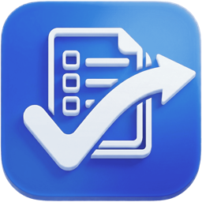
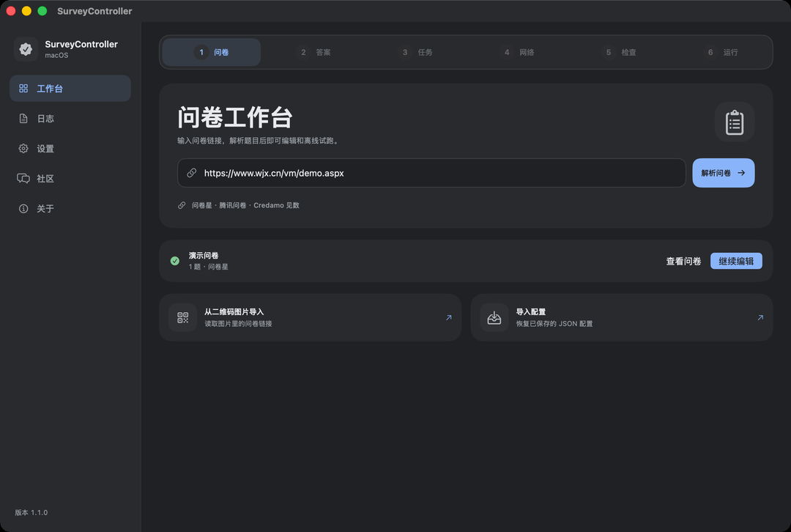

<div align="center">
  <h1>SurveyController Mac</h1>
  <p></p>
  <p>在 macOS 上解析问卷、配置答案策略，并对已获授权的问卷进行自动化测试。</p>
  <p>支持问卷星、腾讯问卷和 Credamo（见数）。需要 macOS 14 或更新版本。</p>
  <p>
    <a href="https://github.com/SurveyController/SurveyController-Mac/releases/latest"></a>
    <a href="LICENSE"></a>
  </p>
  <p><a href="#下载安装">安装说明</a> · <a href="#功能特性">功能特性</a> · <a href="#交流与贡献">交流与贡献</a></p>
  <p><a href="static/screenshot/workspace-dark.png"></a></p>
  <p><sub>v1.2.0 · macOS 深色工作台</sub></p>
</div>

> [!IMPORTANT]
> 本项目面向 HTTP 接口学习和问卷测试。请先取得问卷所有者的授权，并在约定的测试范围内使用。

## 功能特性

| 能力 | 问卷星 | 腾讯问卷 | Credamo（见数） |
| --- | --- | --- | --- |
| 粘贴链接或导入二维码图片 | 支持 | 支持 | 支持 |
| 自定义答案比例 | 支持 | 支持 | 支持 |
| 自定义 AI 填空 | 支持 | 支持 | 支持 |
| 设置作答时长 | 支持 | 支持 | 支持 |
| 从 Excel 反填 | 支持 | — | — |
| 设置作答日期窗口 | — | — | 支持 |

Mac 端使用 SwiftUI 原生工作区，支持配置导入导出、任务暂停与恢复、运行日志存档。任务参数可调整并发、提交间隔、代理地区和设备类型，量表题支持信度计划。配置文件可用于在桌面端和移动端之间迁移设置，具体可用项受问卷平台和题型影响。

工作台支持题目搜索、配置检查跳转和离线试跑。使用同一份配置和随机种子，可以在本机复现最多 20 份样例，查看逐题答案、规则命中和选项分布。试跑只生成本地预览，AI 填空显示占位文本。

## 开始使用

### 使用要求

- macOS 14（Sonoma）或更新版本，支持 Apple Silicon 和 Intel Mac。

### 下载安装

1. 在 GitHub Releases 下载 `macOS.dmg` 安装包。 [下载最新稳定版](https://github.com/SurveyController/SurveyController-Mac/releases/latest)
2. 打开磁盘映像，把 **SurveyController.app** 拖到「应用程序」。也可以下载 ZIP 并解压得到应用。

当前发布包未经 Apple 公证。遇到系统提示时，请核对下载来源并参阅 Apple 的说明。 [在 Mac 上安全地打开 App](https://support.apple.com/zh-cn/102445)

### 从源码运行

需要 Xcode 16 或更新版本。打开 `SurveyController.xcodeproj`，选中 `SurveyController` scheme 后运行，也可以使用命令行。

```bash
git clone https://github.com/SurveyController/SurveyController-Mac.git
cd SurveyController-Mac
xcodebuild -project SurveyController.xcodeproj -scheme SurveyController build
xcodebuild -project SurveyController.xcodeproj -scheme SurveyController test
```

## 使用方法

1. 粘贴公开问卷链接或导入二维码图片，解析问卷。
2. 在「答案」里调整题目权重和填空内容，再设置任务参数和连接选项。
3. 检查配置后，在测试问卷上执行任务。

可以在「设置」中配置自定义 AI。密钥存入 macOS 钥匙串，默认从导出的配置中省略。 [上游使用教程](https://surveydoc.hungrym0.com/)

## 交流与贡献

- 遇到问题时，请提供应用版本、macOS 版本、复现步骤和预期结果。分享截图或日志前请隐去密钥和问卷数据。 [GitHub Issues](https://github.com/SurveyController/SurveyController-Mac/issues)
- 欢迎贡献 macOS 原生交互、题型兼容性和测试用例。 [贡献指南](CONTRIBUTING.md) · [行为准则](CODE_OF_CONDUCT.md)
- 开发者可以从上游核心库了解平台和题型的适配方式。 [surveycore-py](https://github.com/SurveyController/surveycore-py)
- QQ 交流群 **346131215**。


## 贡献者与许可

感谢 [shiaho777](https://github.com/shiaho777)、[hungryM0](https://github.com/hungryM0) 和上游团队的贡献。Mac 端是社区维护的 macOS 移植版，源码按 GPL-3.0 分发。 [Windows 上游](https://github.com/SurveyController/SurveyController) · [Android 版](https://github.com/SurveyController/SurveyController-Android) · [许可证](LICENSE) · [Star History](https://www.star-history.com/#SurveyController/SurveyController-Mac&type=date)
